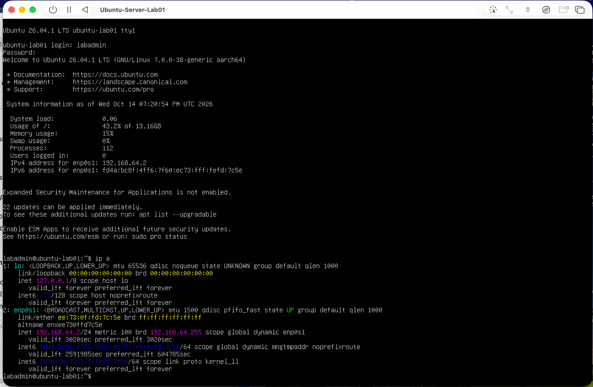
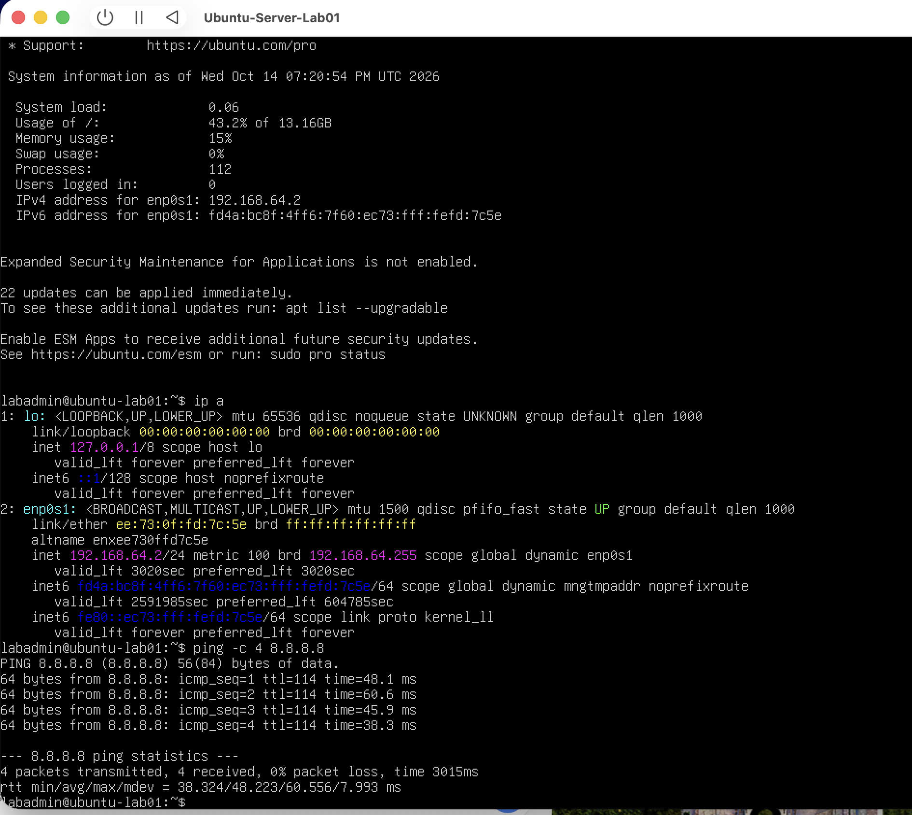
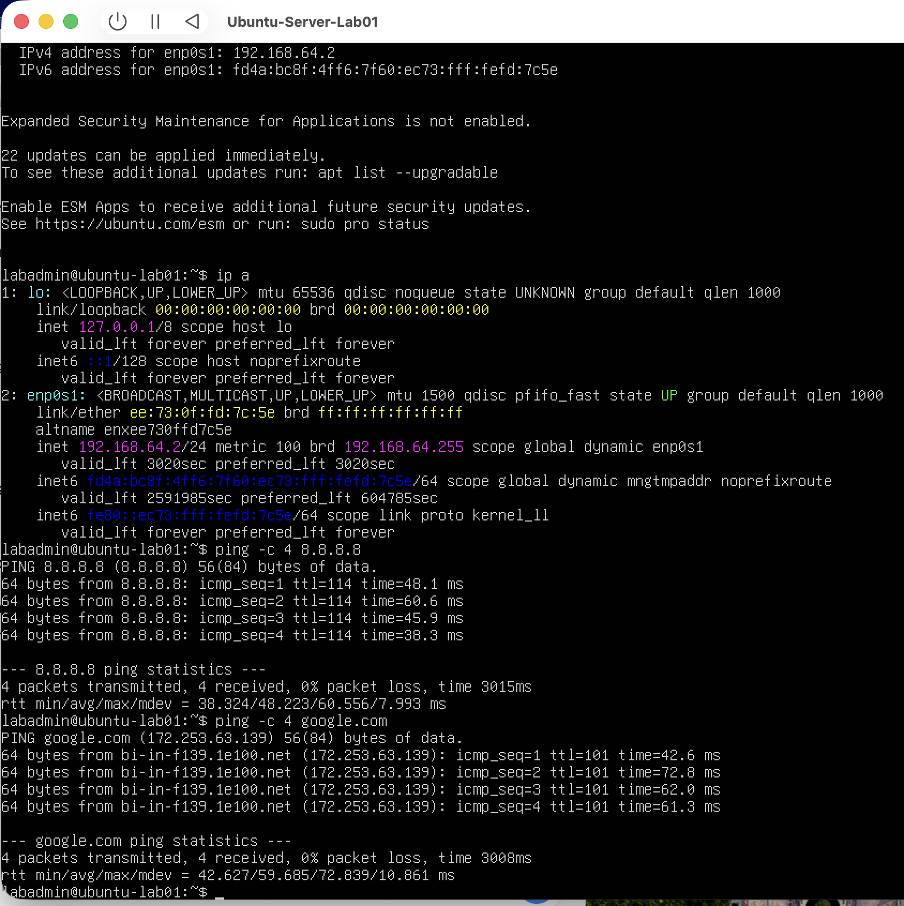
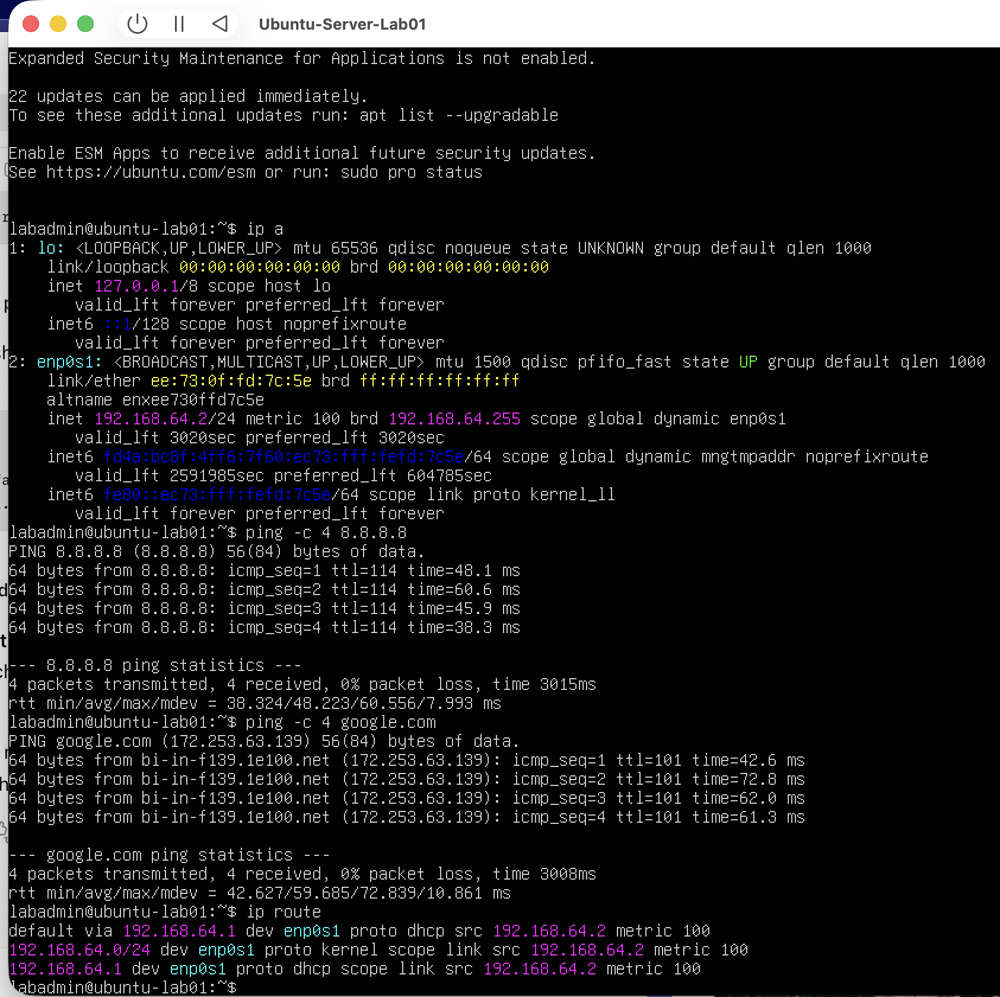
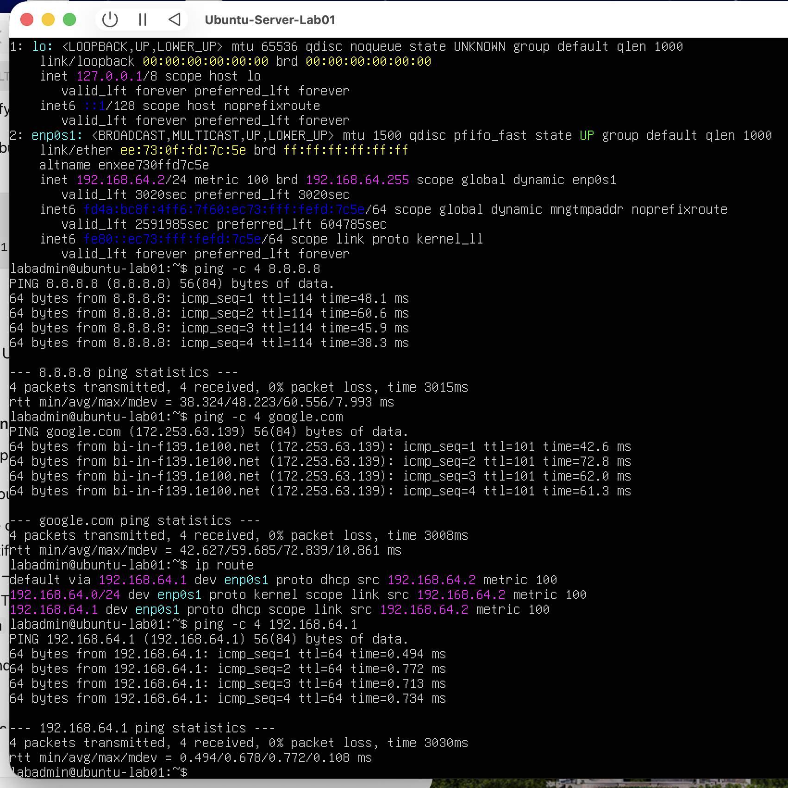

# Linux Networking and Connectivity Troubleshooting Lab

## Project Overview

This hands-on lab demonstrates foundational Linux networking, network diagnostics, and connectivity troubleshooting using an Ubuntu Server virtual machine.

The objective was to inspect network configurations, verify internet connectivity, validate DNS resolution, and analyze routing information using Linux command-line tools.

## Lab Environment 

- Operating System: Ubuntu Server
- Environment: Virtual Machine
- Architecture: ARM64
- Network Interface: enp0s1
- IPv4 Address: 192.168.64.2/24
- Default Gateway: 192.168.64.1
- IP Assignment: DHCP

## Technical Skills Demonstrated

- Linux command-line administration
- Network interface analysis
- IPv4 and IPv6 addressing
- DHCP configuration verification
- DNS resolution testing
- ICMP connectivity testing
- Routing table analysis
- Default gateway verification
- Network troubleshooting methodology

## Lab Procedures

### 1. Inspect Network Interfaces

Command: `ip a`

Identified active network interfaces, assigned IP addresses, subnet information, and interface status.

### 2. Verify External Internet Connectivity

Command: `ping -c 4 8.8.8.8`

Tested connectivity to an external public IP address independently of DNS resolution.

Results:
- 4 packets transmitted
- 4 packets received
- 0% packet loss
- Average latency: 48.223 ms

### 3. Validate DNS Resolution

Command: `ping -c 4 google.com`

Verified that the system could resolve a domain name to an IP address and communicate with the destination.

Results:
- Successful hostname resolution
- 0% packet loss
- Average latency: 59.685 ms

### 4. Analyze Routing Configuration

Command: `ip route`

Examined the system routing table, identified the default gateway, and verified the local network route.

### 5. Verify Default Gateway Connectivity

Command: `ping -c 4 192.168.64.1`

Confirmed communication between the Ubuntu virtual machine and its default gateway.

Results:
- 4 packets transmitted
- 4 packets received
- 0% packet loss
- Average latency: 0.678 ms

## Troubleshooting Methodology

The following diagnostic approach can be applied to common network connectivity incidents:

1. Verify network interface status and IP configuration.
2. Confirm the presence of a valid default route.
3. Test connectivity to the local default gateway.
4. Test connectivity to an external IP address.
5. Verify DNS resolution using a domain name.

This approach helps isolate potential issues involving local connectivity, routing, external network access, and DNS.

## Lab Results

All connectivity tests completed successfully with zero packet loss. The virtual machine demonstrated functional IP addressing, routing, DNS resolution, and external network connectivity.

## Real-World Applications

The skills demonstrated in this lab are applicable to:

- IT Support
- Technical Support Engineering
- Linux System Administration
- Network Operations
- Cloud Infrastructure Support
- Cybersecurity Operations

## Project Status

Completed - Successfully tested and documented.
